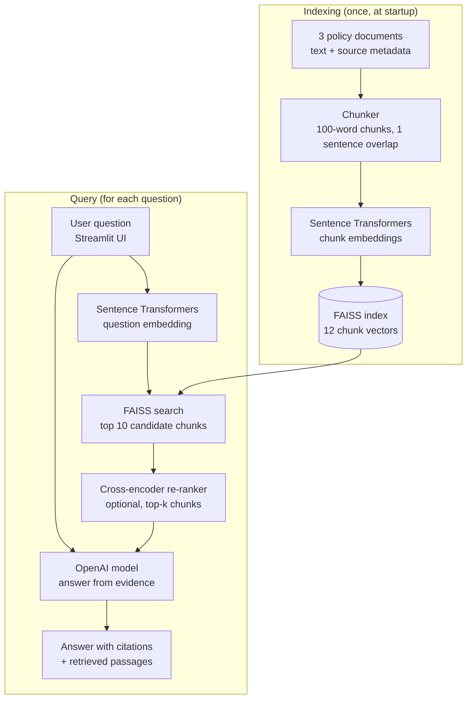

# Enterprise Knowledge Assistant

A prototype Retrieval-Augmented Generation (RAG) application
that answers questions using synthetic company policy documents.
This project created by AI and only for interview purpose. 
I keep it small and not complicated only to show the importance and fundamentals here.

## Architecture

1. Documents are represented as text with source metadata.
2. Each document is split into overlapping, sentence-aligned chunks
   of up to 100 words that keep the source metadata.
3. Sentence Transformers generates chunk embeddings.
4. FAISS retrieves the most similar chunks as candidates.
5. A cross-encoder re-ranks the candidates against the question
   (can be switched off in the sidebar).
6. An OpenAI model generates an answer from retrieved evidence.
7. Streamlit provides the user interface.

## Technology

- Python
- Sentence Transformers
- FAISS
- OpenAI API
- Streamlit
- pytest

## Current limitations

- Uses three synthetic documents.
- No PDF ingestion in the current UI; only the built-in text is chunked.
- No authentication or document-level authorization.
- Retrieval relevance thresholds are not calibrated.
- Answer grounding and citations are not independently verified.
- Not production-ready. (Just for Demo)

## Future improvements

- PDF ingestion
- Retrieval evaluation and answer verification
- Authentication and authorization
- Structured logging and latency/cost monitoring
- Broader automated test coverage
- Provider-independent LLM interface