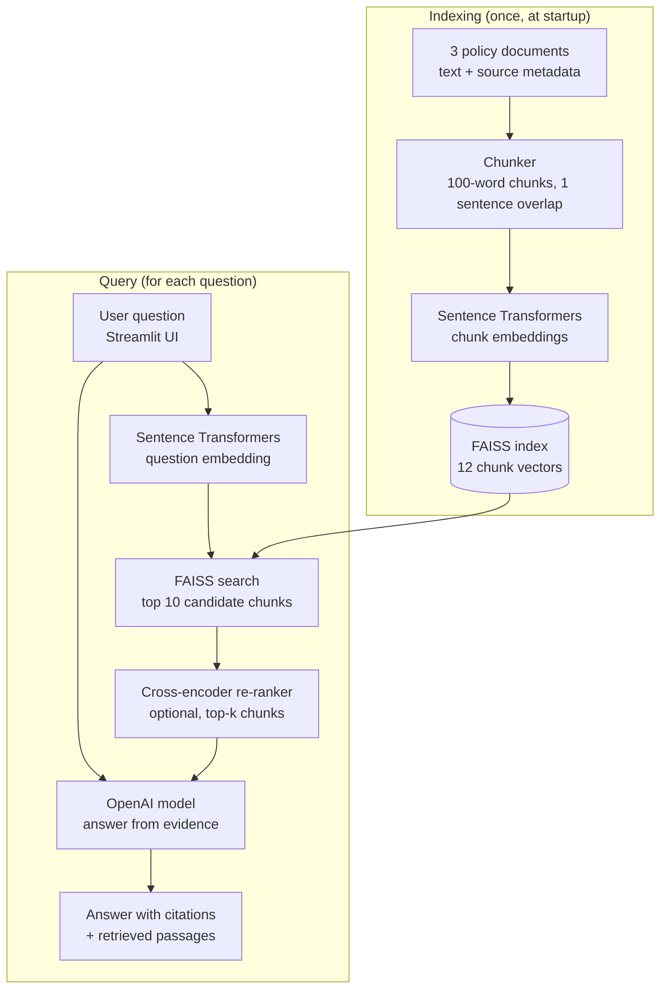

# Enterprise Knowledge Assistant

👉🏻 [Click Here to test it](https://let-s-go-k5n5aezkatrvc7v6hjxfhv.streamlit.app/) *(Please allow a few seconds for the app to load)*

A prototype Retrieval-Augmented Generation (RAG) application
that answers questions using synthetic company policy documents.
This project is only for interview purpose. 
I keep it small and not complicated only to show the importance and fundamentals here.

In the Streamlit Demo you can adjust retrieve passage numbers and see them as results below generated answers:

## Architecture

1. Documents are represented as text with source metadata.
2. Each document is split into overlapping, sentence-aligned chunks
   of up to 100 words that keep the source metadata.
3. Sentence Transformers generates chunk embeddings.
4. FAISS retrieves the most similar chunks as candidates.
5. A cross-encoder re-ranks the candidates against the question
   (can be switched off in the sidebar).
6. An OpenAI model generates an answer from retrieved evidence.
7. Streamlit provides the user interface.

## Models

| Step | Model | Runs | Characteristics |
|---|---|---|---|
| Embedding | `sentence-transformers/all-MiniLM-L6-v2` | Locally, on CPU | About 22M parameters, 384-dimensional vectors, reads up to 256 tokens per text |
| Re-ranking | `cross-encoder/ms-marco-MiniLM-L-6-v2` | Locally, on CPU | About 22M parameters, reads question and passage together (up to 512 tokens), trained on MS MARCO passage ranking |
| Answer generation | `gpt-4o-mini` (OpenAI) | OpenAI API | Hosted model, paid per token, 128k-token context window |

Why I chose these models:

- **Embedding model**: small, fast and free to run on CPU, and a
  widely used baseline for semantic search. Its 256-token limit is
  the reason chunks are capped at 100 words.
- **Re-ranking model**: it scores each question and passage as a
  pair, which is more accurate than comparing two separate vectors
  but too slow to run over every chunk, so it only re-orders the
  top 10 candidates from FAISS. It is the same size as the
  embedding model, so it adds little memory.
- **Answer model**: low cost and low latency, and good enough for
  short answers that only restate retrieved evidence. It can be

## Technology

- Python
- Sentence Transformers
- FAISS
- OpenAI API
- Streamlit
- pytest

## Current limitations

- Uses three synthetic documents.
- No PDF ingestion in the current UI; only the built-in text is chunked.
- No authentication or document-level authorization.
- Retrieval relevance thresholds are not calibrated.
- Answer grounding and citations are not independently verified.
- Not production-ready. (Just for Demo)
- For reducing latency we can add Token streaming which Improves User Engagement, reduce perceived latency by delivering AI-generated text piece by piece as it is created, rather than making the user wait for the entire response to finish. (since i used synthetic small dataset i didn't apply it)

## Future improvements

- PDF ingestion
- Retrieval evaluation and answer verification
- Authentication and authorization
- Structured logging and latency/cost monitoring
- Broader automated test coverage
- Provider-independent LLM interface
- For precise answer also we can use hybrid search (Dense + Sparse) It's only a very small project to show the pipeline design
